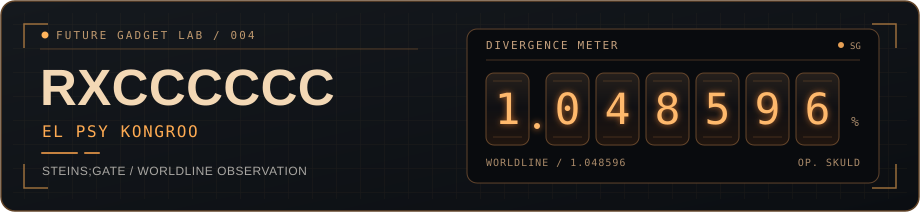

<!--
Steins;Gate themed profile - RXCCCCCC
-->

<p align="center">
  
</p>

<p align="center">
  <a href="https://blog.rxcccccc.icu/"></a>
  <a href="mailto:xiongchao.rao@gmail.com"></a>
</p>

<details>
<summary>Worldline Observation Log</summary>

<!--WORLDLINE:START-->
```text
 [LAB MEM 004] WORLDLINE OBSERVATION LOG
 ─────────────────────────────────────────────
  Divergence     : 1.048596 %  (Steins;Gate)
  Lab Time (CST) : 2026-11-27 16:45
  Status         : Reading Steiner — INACTIVE
  Operation      : SKULD — profile auto-sync OK
 ─────────────────────────────────────────────
```
<!--WORLDLINE:END-->

</details>

## 🧪 About Me

- 👋 I'm **Xiongchao Rao** (RXCCCCCC).
- 🎓 Undergraduate student majoring in **Software Engineering** at **Dalian University of Technology**.

## 🔬 Research Interests

- **Multimodal Understanding & Generation**
- **Real-time Multimodal Human-AI Interaction**
- **AI Agents & Self-Evolving Systems**

## 🏆 Honors

| Award | Achievement |
| :--- | :--- |
| National Scholarship | **2024–2025 & 2025–2026** |
| Challenge Cup 2026 — Challenge-based Special Competition | **National Second Prize** |
| 17th Lanqiao Cup — C/C++ Programming, Group A | National Third Prize · Liaoning Provincial First Prize |
| Asia-Pacific Mathematical Contest in Modeling (APMCM 2025) | Third Prize |
| 2026 AIGC Innovation Competition — Application Track | Northeast Regional Second Prize |

## 🛠️ Tech Stack

<p align="center">
  
</p>

## 📌 Featured Engineering Projects

<table align="center" width="100%">
  <tr>
    <td align="center" valign="top" width="50%">
      <a href="https://github.com/RXCCCCCC/lanxin-travelmate-aigc-2026"><b>TravelMate</b></a><br/>
      <sub>Memory-Augmented Travel Agent</sub><br/><br/>
      A travel agent featuring graph-based orchestration, structured tool planning, and human-in-the-loop memory management.<br/><br/>
      
      
      <a href="https://github.com/RXCCCCCC/lanxin-travelmate-aigc-2026"></a>
    </td>
    <td align="center" valign="top" width="50%">
      <a href="https://github.com/RXCCCCCC/dlut-aigc-project"><b>DLUT AIGC</b></a><br/>
      <sub>Multimodal 3D Generation Platform</sub><br/><br/>
      A web platform integrating text-to-3D and image-to-3D generation services with interactive 3D visualization.<br/><br/>
      
      
      <a href="https://github.com/RXCCCCCC/dlut-aigc-project"></a>
    </td>
  </tr>
</table>

## 📊 Stats

<p align="center">
  
</p>

<p align="center">
  
</p>

## 🐍 Contribution Snake

<p align="center">
  <picture>
    <source media="(prefers-color-scheme: dark)" srcset="https://raw.githubusercontent.com/RXCCCCCC/RXCCCCCC/output/github-snake-dark.svg" />
    
  </picture>
</p>

<p align="center">
  <a href="mailto:xiongchao.rao@gmail.com"></a>
  
</p>

<p align="center">
  
</p>
